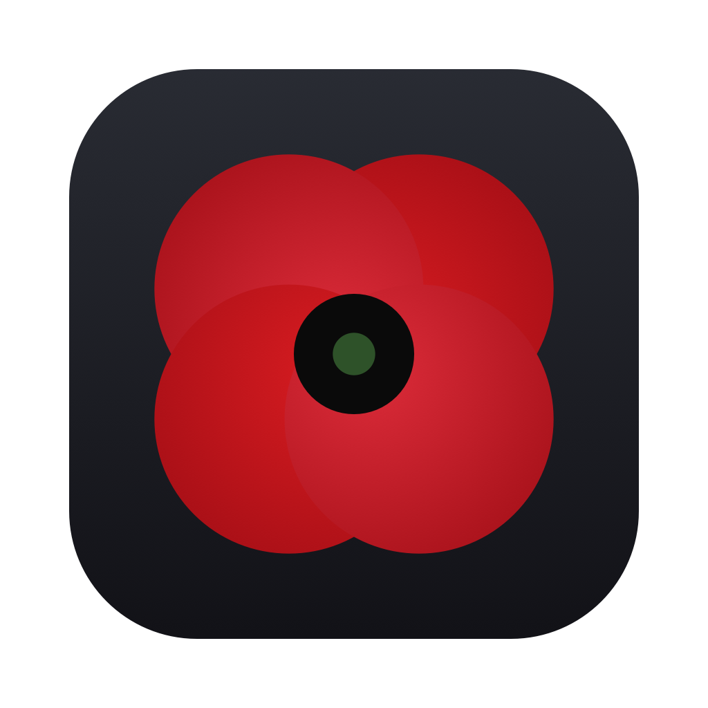

<p align="center"></p>

<h1 align="center">Remembrance</h1>

A small macOS app for running the audio at a Canadian Remembrance Day service: **O Canada**, **the
Last Post**, **two minutes of silence**, **the Rouse** and **God Save the King**, using the official
Government of Canada recordings.

<p align="center"></p>

## Running the service

- **Space** plays the selected cue. Space does nothing while a cue is sounding, so a double press
  can't restart anything.
- **Esc** fades out over 1.5 s; **Shift-Esc** stops at once. **↑/↓** move the selection.
- **O Canada starts whenever the MC calls for it**: press Space then. The app only shows the
  deadline (10:57:05 for an 11:00 silence), turning into a countdown in the last minute.
- After O Canada the MC speaks (welcome, what to expect), and the app counts down to **the Last
  Post, which starts by itself** at its scheduled time (10:58:43) so its last note sounds at 11:00.
  If O Canada ran right up to the deadline it follows 5 seconds after. While it waits, Space starts
  it now and Esc cancels.
- When the Last Post ends, **the two-minute silence starts by itself** and counts down. Then the
  Rouse is selected and waits for you. If no piper plays a Lament, tick "Play the Rouse when the
  silence ends" to play it automatically.
- "Silence at" changes the target time for services that aren't at 11:00; every other time moves
  with it.
- The header shows the Mac's **sound output** (check it says your PA/speaker, not "MacBook Pro
  Speakers"). The Mac won't sleep or dim while the app is open, and it asks before quitting
  mid-cue.
- To use a different recording for any cue (say, a live bugler's recording), right-click its row →
  **Use a Different Recording…**.

Recordings are timed by where the sound dies away, not the end of the file. The official Last Post
has about 7 seconds of quiet room tail; ignoring it keeps the silence starting on time.

See **[docs/ORDER-OF-SERVICE.md](docs/ORDER-OF-SERVICE.md)** for the researched order of service,
timings and sources.

## Install

Download the DMG from [Releases](https://github.com/rdougan/remembrance/releases) and drag
Remembrance to Applications. Releases are signed with Developer ID and notarized.

## Build

Needs only the Xcode Command Line Tools (macOS 14+):

```sh
scripts/build-app.sh      # downloads the recordings, builds build/Remembrance.app (ad-hoc signed)
open build/Remembrance.app
```

To refresh the README screenshot (2x, with the window frame):

```sh
REMEMBRANCE_CLOCK=10:54:30 REMEMBRANCE_SNAPSHOT=/tmp/shot build/Remembrance.app/Contents/MacOS/Remembrance &   # writes /tmp/shot-2.png
swift scripts/frame-screenshot.swift /tmp/shot-2.png docs/screenshot.png
```

Every push to `main` that changes the app builds, signs, notarizes and publishes a release
(`.github/workflows/release.yml`, the same signing steps as the finances app). One-time setup on
the Mac with the certificate:

```sh
scripts/set-release-secrets.sh <DeveloperID.p12> <AuthKey_XXXXXXXXXX.p8> <issuer-id>
```

## Recordings

Not stored in this repo; `scripts/fetch-audio.sh` downloads them from canada.ca at build time.

- O Canada and God Save the King (instrumentals): Canadian Heritage. God Save the King is public
  domain.
- Last Post and Rouse: Canadian Armed Forces, *Music for commemorative ceremonies*. Crown
  copyright, provided for public use.
